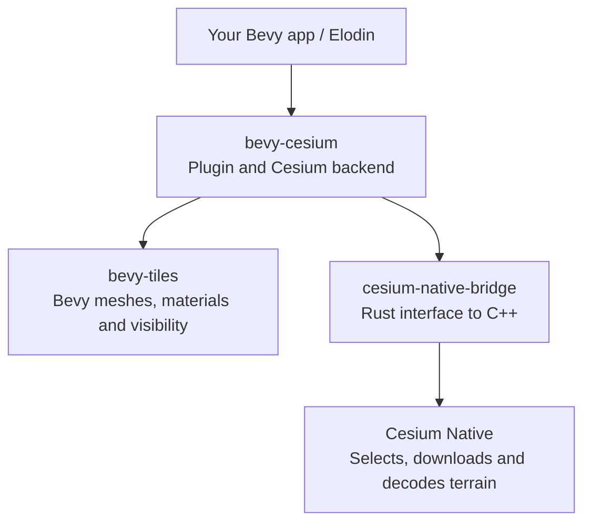

# Bevy-Cesium

Load real terrain, aerial imagery and 3D Tiles into a Bevy application.
Cesium Native downloads and selects the data; Bevy renders it locally.

Built for **Bevy 0.19** and **Cesium Native 0.65.0**. Experimental,
maintained by Elodin independently of Cesium. Tested locally on Apple Silicon macOS.

## Structure

The three Rust crates live in this repository. Applications depend on
`bevy-cesium`; the other two are internal building blocks.
`bevy-tiles` is our existing shared renderer, also used by Caevy.



Install from GitHub using a pinned commit or tag. These crates are not published
to crates.io.

## Demo

Earlier integration in Elodin, using the public AGI headquarters 3D Tiles sample:

https://github.com/user-attachments/assets/8cc6c6b6-20e7-4b96-a51c-ef1f1659bdb0

## Try it

```sh
nix develop
just prepare   # build the native SDK once, or set CESIUM_NATIVE_DIR
just install
just viewer    # public 3D Tiles example; no token needed
```

For Cesium ion terrain and aerial imagery, set `CESIUM_ION_ASSET_ID=1`,
`CESIUM_ION_IMAGERY_ASSET_ID=2` and `CESIUM_ION_TOKEN` before launching.
Keep the token out of source control. The viewer's location is set with
`CESIUM_LAT`, `CESIUM_LON` and `CESIUM_ALT`. Use `CESIUM_TILESET_URL` for another tileset.

## Use it in an app

Add `CesiumPlugin`, mark your cameras with `CesiumCamera`, and set
`CesiumGeoreference` to map Earth coordinates into your scene.
The [standalone viewer](examples/viewer.rs) is a complete example.
Your app supplies lighting and displays the source attribution from `CesiumCredits`.

```rust,ignore
app.add_plugins(
    CesiumPlugin::new(source)
        .with_maximum_screen_error(16.0)
        .with_initial_load_wait()
        .with_lod_retention_margin(500.0),
);
```

The screen-error setting controls detail: smaller values request finer terrain.
The retention setting keeps acquired detail until it leaves all camera views,
with an extra margin in meters. Retention is off by default; this example enables it.

## Terrain stability

- **Startup:** `.with_initial_load_wait()` keeps provisional terrain hidden until
  the first selection and its images are loaded and ready on the GPU. Very coarse
  terrain can otherwise pass above a low-flying camera. The app should show a
  loading message and set a timeout. This wait applies only to the first load.
  Extra coarser and neighboring tiles are not preloaded.
- **Flickering:** downloaded terrain may still be waiting for the GPU. Bevy-Cesium
  keeps the old terrain visible until its replacement is ready, then swaps it in
  together. Texture updates follow the same rule, avoiding temporary holes and
  overlapping versions during the swap.
- **LOD (level of detail):** terrain normally becomes more detailed up close and
  coarser farther away. With retention enabled, moving away keeps the detail
  already acquired until the area leaves every camera view, including the margin.
  This uses more memory; the unused-cache budget does not cap retained terrain.
- **Several cameras:** detail needed by any supplied camera is kept. A temporary
  gap with no cameras does not clear it.

Elodin's RC-jet example enables a **500 m margin** and **16 px screen error**.
Elodin pins an exact Git revision of Bevy-Cesium and shows a loading message
until the initial terrain is ready. The simulation continues during loading.
The color sensor is enabled. The zoomed infrared sensor is temporarily disabled
in Cesium mode because it greatly increases initial loading time. Its panel stays
visible without a stream; loading time, image quality and performance remain to be validated.
Downloaded data is not yet cached on disk.

Rendering terrain does not add ground contact to the simulation. An aircraft
flying below the surface sees the undersides and vertical edges of tiles.
`TerrainSampler` reads the most detailed terrain heights before a simulation
starts, independently of camera LOD. Heights are meters above the WGS84 ellipsoid.
Queries have a timeout and fail if any height is missing. The simulation must
use these heights for its own contact model. Elodin RC-jet prepares a fixed height
grid before the flight, resolves ground contact and continues the simulation.
Its grid is an approximation; it is not a collision mesh or an aircraft damage model.

## Controlled captures

For a known camera path, supply all reference views before loading:

```rust,ignore
app.insert_resource(CesiumDetailViews(reference_camera_path))
    .insert_resource(CesiumSelectionMode::Fixed);
```

This makes terrain selection depend on those views instead of the live preview.
Wait for `CesiumStatus::ready_for_capture()` before saving an image: terrain and
imagery must be loaded, ready on the GPU, and unchanged for eight updates.
Set a timeout and allow the camera's rendering pipelines to warm up too.

In Elodin, `ELODIN_CESIUM_CAPTURE_VIEWS` selects the reference-view JSON file.
Captures fail on loading errors or after `ELODIN_CESIUM_CAPTURE_TIMEOUT`
(120 seconds by default). Camera positions, viewing angles and image sizes
must cover the intended flight and sensors.

**Repeatable CI (automated tests) still needs fixed input data.** Online ion data
can change. Identical pixels also require a controlled rendering environment.

## Progress

- [x] Stream terrain, aerial imagery and 3D Tiles into Bevy.
- [x] Keep the previous terrain visible until replacement geometry and textures
  are ready on the GPU.
- [x] Retain acquired detail while any camera still needs the area, with a margin.
- [x] Share retention selection work across tiles to avoid slowing down as detail accumulates.
- [x] Avoid slow per-byte copies when loading images.
- [x] Wait for initial terrain and images before showing them; test startup locally.
- [x] Support multiple cameras and preserve detail during gaps between captures.
- [x] Support fixed reference views and signal when terrain is ready to capture.
- [x] Test loading failures, detail retention and GPU transitions with local assets;
  validate the integration locally in RC-jet.
- [x] Validate RC-jet's color sensor locally and keep it enabled.
- [ ] Reduce loading time and validate image quality and performance of RC-jet's
  infrared sensor, then enable it again in Cesium mode.
- [ ] Cache downloaded terrain and imagery on disk for reuse between runs.
- [ ] Save a complete terrain package for a chosen region and camera path,
  with a version and file checksums to verify its contents.
- [ ] Load that package without network access; report missing or damaged files.
- [ ] In Elodin, replay RC-jet in CI with the same package and camera poses,
  wait for rendering to be ready, then compare captures.
- [ ] During interactive use, load the package first and download extra terrain
  when the camera leaves its coverage.
- [x] Add terrain-height queries for simulation ground contact, separately from rendering.

## Development

`just test` and `just check` run the tests and code checks. Tests cover detail
retention and release, multiple cameras, incomplete loads and delayed GPU uploads.
For a visual example with two views and terrain/texture swaps:

```sh
CESIUM_STABILITY_OUTPUT=/tmp/terrain-stability \
  cargo run --release --example terrain_stability
```

To measure terrain selection after loading, set `CESIUM_ION_TOKEN` and run
`cargo run --release -p cesium-native-bridge --example retention_profile -- 500`.
Compare with `100` and `0` meters. This measures CPU selection, not rendering FPS;
zero disables detail retention.

For custom coordinate systems such as Elodin's floating origin, use
`.with_external_coordinates()`, supply `CesiumViews` in ECEF (Earth-centered,
Earth-fixed coordinates), and place `CesiumPrimitive` entities yourself.
The update order is `Views → Stream → Placement → Publish`; move cameras before
`Views`, place terrain in `Placement`, and check capture readiness after `Publish`.
See the [Bevy-Cesium API reference](https://elodin-sys.github.io/bevy-cesium/bevy_cesium/).
Ion imagery currently supports one shared overlay per process, using the terrain token.
