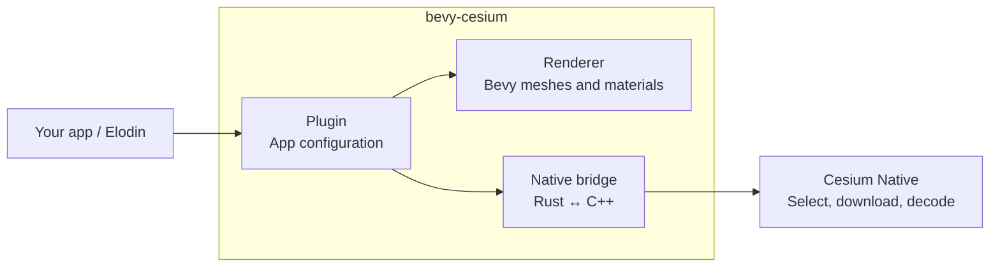

# Bevy-Cesium

Load real terrain, aerial imagery and 3D Tiles into a Bevy application.
Cesium Native downloads and selects the data on native targets. On
`wasm32-unknown-unknown`, a Rust browser backend loads the data with Fetch.
Both use the same Bevy renderer, coordinate adapter and GPU readiness tracking.

Built for **Bevy 0.19** and **Cesium Native 0.65.0**. Experimental,
maintained by Elodin independently of Cesium. Tested locally on Apple Silicon macOS.

[API reference](https://elodin-sys.github.io/bevy-cesium/bevy_cesium/)
· [Examples](examples)

## Structure

One public crate, `bevy-cesium`, with an internal `tiles-core` loader for the browser.
The native path has three parts:



Use a pinned Git commit or release tag. The crate is not published to crates.io.

## Browser

`CesiumPlugin` selects its backend by target: Cesium Native on native platforms,
`BrowserBackend` on WASM. No Cargo feature is needed. The browser build does not
compile the C++ bridge or link a Cesium Native SDK.

From the repository root:

```sh
nix develop
just install web
just web
```

Open `http://127.0.0.1:8842`. The small fixture loads its tileset and geometry
from relative HTTP paths on that server and reports when the GPU is ready.
It needs WebGPU, but no ion account, token, external tiles or application backend.

Applications pass `CesiumSource::Url` or `CesiumSource::Terrain` an absolute HTTP(S)
URL. Child content URLs are resolved relative to their tileset/layer URL; serving
the same directory from a database asset server requires no database-specific
code here. The server must allow browser access (same origin or suitable CORS).
`file:` URLs are not supported by browser Fetch. The host supplies ion tokens
explicitly through `CesiumSource::Ion`; there is no global JavaScript token or
demo account in the library.

| Capability | Native | Browser |
| --- | --- | --- |
| Explicit 3D Tiles, nested tilesets, glTF/GLB and Draco mesh decoding | Yes | Yes |
| Ion 3D Tiles source | Yes | Yes |
| Quantized-mesh terrain URL | Yes | Yes |
| Geographic TMS imagery on a terrain URL | Not exposed by the bridge | Yes |
| `IonTerrain` with ion imagery | Yes | Not yet; returns an error |
| LOD retention margin | Yes | Not yet; nonzero margins return an error |
| Terrain height sampling (`TerrainSampler`) | Yes | Not exposed |
| Persistent local HTTP cache | Yes | Browser HTTP caching only |

Browser terrain layers must use EPSG:4326/TMS and static availability for levels
above 6 (maximum level 24). Dynamic metadata availability and parent layers are
not supported. Imagery must match the terrain's geographic tile grid; arbitrary
imagery services are not reprojected. Unsupported layers return an error.

The browser loader is a bounded subset, not a port of all Cesium Native formats.
It fetches at most four tile jobs concurrently, bounds each response to 32 MiB,
and limits hierarchy size/depth. The unused-tile cache budget does not cap active
tiles, decode allocations, or GPU memory. Decoding currently runs on the browser
thread. The host should set a startup timeout and report errors through
`CesiumStatus`; there is no silent fallback to a different terrain source.

This integrates the backend from the
[terrain demo](https://github.com/elodin-sys/elodin-terrain-demo/tree/1896eac25355841dd725013e9579b95680be6162/browser-backend),
without its deployment configuration or Falcon9-specific changes.
Preparing portable terrain packages and connecting an editor to a database
remain application responsibilities.

## Demo

Earlier integration in Elodin, using the public AGI headquarters 3D Tiles sample:

https://github.com/user-attachments/assets/8cc6c6b6-20e7-4b96-a51c-ef1f1659bdb0

## Try it

```sh
nix develop
just prepare   # build the native SDK once, or set CESIUM_NATIVE_DIR
just install
just viewer    # public 3D Tiles example; no token needed
```

For Cesium ion terrain and aerial imagery, set `CESIUM_ION_ASSET_ID=1`,
`CESIUM_ION_IMAGERY_ASSET_ID=2` and `CESIUM_ION_TOKEN` before launching.
Keep the token out of source control. The viewer's location is set with
`CESIUM_LAT`, `CESIUM_LON` and `CESIUM_ALT`. Use `CESIUM_TILESET_URL` for another tileset.

## Use it in an app

Add `CesiumPlugin`, mark your cameras with `CesiumCamera`, and set
`CesiumGeoreference` to map Earth coordinates into your scene.
The [standalone viewer](examples/viewer.rs) is a complete example.
Your app supplies lighting and displays the source attribution from `CesiumCredits`.

```rust,ignore
app.add_plugins(
    CesiumPlugin::new(source)
        .with_maximum_screen_error(16.0)
        .with_initial_load_wait()
        .with_lod_retention_margin(500.0),
);
```

The screen-error setting controls detail: smaller values request finer terrain.
The retention setting keeps acquired detail until it leaves all camera views,
with an extra margin in meters. Retention is off by default; this example enables it.

For applications that receive their dataset after startup, install
`CesiumPlugin::deferred()` instead. Insert `CesiumSourceUpdate(Some(source))`
into the Bevy world when the configuration arrives. A replacement drops the
previous tileset and its geometry; `CesiumSourceUpdate(None)` disables streaming.
The same plugin settings apply to each replacement.

## Terrain stability

- **Startup:** `.with_initial_load_wait()` keeps provisional terrain hidden until
  the first selection and its images are loaded and ready on the GPU. Very coarse
  terrain can otherwise pass above a low-flying camera. The app should show a
  loading message and set a timeout. This wait applies only to the first load.
  Extra coarser and neighboring tiles are not preloaded.
- **Flickering:** downloaded terrain may still be waiting for the GPU. Bevy-Cesium
  keeps the old terrain visible until its replacement is ready, then swaps it in
  together. Texture updates follow the same rule, avoiding temporary holes and
  overlapping versions during the swap.
- **LOD (level of detail):** terrain normally becomes more detailed up close and
  coarser farther away. With retention enabled, moving away keeps the detail
  already acquired until the area leaves every camera view, including the margin.
  This uses more memory; the unused-cache budget does not cap retained terrain.
- **Several cameras:** detail needed by any supplied camera is kept. A temporary
  gap with no cameras does not clear it.

Elodin's RC-jet launcher defaults to 48 px screen error and disables detail
retention on a shared laptop GPU. Color and infrared previews are both enabled;
co-located, aligned sensors share the wider camera's terrain selection. Elodin
pins an exact Git revision of Bevy-Cesium and waits for the initial terrain
before emitting sensor images. The simulation continues during loading.
Native rendering and height queries share a persistent HTTP cache, enabled by
default. Responses are stored in `$XDG_CACHE_HOME/bevy-cesium/terrain`, falling
back to `~/.cache/bevy-cesium/terrain`. Missing or expired responses are fetched
and cached according to the provider's HTTP cache rules. A session warns once
when network access is needed. If the cache cannot be opened, loading continues
without it.

Native tile loading and cache eviction use soft CPU budgets of 2 ms and 1 ms per
update. Terrain textures release their CPU pixels after render extraction;
meshes retain CPU data for host raycasts. Hosts can use Bevy's
`RenderAssetBytesPerFrame` to spread mesh/image uploads across frames (Elodin
uses 8 MiB for Cesium sessions). Each limit can be exceeded by one indivisible
operation. Publication still waits for a complete GPU-ready selection.
Enable `bevy_cesium::render=trace` logging for per-update backend and CPU asset
preparation timings; those are not GPU timings.

Rendering terrain does not add ground contact to the simulation. An aircraft
flying below the surface sees the undersides and vertical edges of tiles.
`TerrainSampler` reads the most detailed terrain heights before a simulation
starts, independently of camera LOD. Heights are meters above the WGS84 ellipsoid.
Queries have a timeout and fail if any height is missing. The simulation must
use these heights for its own contact model.
Reuse one sampler across batches (up to one million positions per call) to keep
the tileset and downloaded tiles. After a query error, retry with a fresh sampler.

Elodin separates the [rendering PR](https://github.com/elodin-sys/elodin/pull/914)
from the [shared terrain API branch](https://github.com/elodin-sys/elodin/tree/work/cesium-terrain-api).
The latter adds `el.terrain_heightmap()` in nox-py: provide an ECEF center,
dimensions and spacing; Elodin prepares and caches the grid, then provides a
JAX lookup. One CLI process samples the grid in batches through Bevy-Cesium,
sharing a native session without going through the Editor's rendering plugin.
RC-jet supplies the contact response. This integration is pending
review, and comes before infrared work.

### Why RC-jet can bounce

The terrain API branch uses a simple spring-and-damper contact model: the ground pushes the aircraft
out, while damping reduces motion into the surface. After each physics step,
Elodin also lifts any penetrating reference point above the ground and removes
velocity into the slope. The aircraft keeps moving, so it can bounce or slide
along hills. This is a simplified contact response, not a realistic crash model.

The onboard camera crossing the ground is a separate limitation. Physics uses
heights sampled every 10 m and estimates the surface between them. The visible
terrain uses meshes whose detail changes with LOD. Those surfaces can differ,
and contact protects the aircraft's reference point, not its entire shape or
the camera mounted ahead of it. Near the ground, the camera may therefore enter
the visible mesh and show its underside. Full airframe and camera collision
handling remains to be added in Elodin.

### Infrared remains disabled

**After the shared terrain API: make RC-jet's infrared camera usable with Cesium.**
It should show estimated heat contrast, while the color camera shows visible light.
The infrared panel stays visible without a stream until this work is validated.

The RC-jet integration has several separate costs to investigate:

- Its 18° zoom asks Cesium for finer terrain than the 90° color camera. Both
  sensors share the initial loading gate, so infrared can delay the color stream.
  Separate online trials took about 12 s for color and 96 s with both sensors;
  these are observations, not a controlled benchmark.
- Elodin's infrared preset renders 640 × 512 at 60 fps, with extra thermal passes
  and GPU-to-CPU transfers. Raw `gray8` output alone is about 20 MB/s, or 6 GB
  for five minutes, before database overhead.
- Cesium imagery is not thermal data. Elodin currently estimates untagged terrain
  temperature from lighting; infrared contrast needs its own validation.

The work is planned in this order:

1. Measure terrain loading, rendering, GPU-to-CPU transfers and recording separately.
2. Set a sustainable frame rate and recording format; prevent infrared startup
   from holding up the color stream.
3. Check heat contrast on terrain and a tagged target, then test both cameras
   together during a long flight before enabling infrared by default.

Bevy-Cesium supplies terrain and shared detail selection; Elodin owns the sensor,
heat approximation, frame scheduling and recording.
The 500 m retention benchmark stayed below 1 ms at the 95th percentile for CPU
selection in the tested route; that does not measure sensor rendering cost.

## Controlled captures

For a known camera path, supply all reference views before loading:

```rust,ignore
app.insert_resource(CesiumDetailViews(reference_camera_path))
    .insert_resource(CesiumSelectionMode::Fixed);
```

This makes terrain selection depend on those views instead of the live preview.
Wait for `CesiumStatus::ready_for_capture()` before saving an image: terrain and
imagery must be loaded, ready on the GPU, and unchanged for eight updates.
Set a timeout and allow the camera's rendering pipelines to warm up too.

In Elodin, `ELODIN_CESIUM_CAPTURE_VIEWS` selects the reference-view JSON file.
Captures fail on loading errors or after `ELODIN_CESIUM_CAPTURE_TIMEOUT`
(120 seconds by default). Camera positions, viewing angles and image sizes
must cover the intended flight and sensors.

**Repeatable CI (automated tests) still needs fixed input data.** Online ion data
can change. Identical pixels also require a controlled rendering environment.

## Progress

- [x] Provide one crate and one API reference, with separate internal modules.

- [x] Stream terrain, aerial imagery and 3D Tiles into Bevy.
- [x] Keep the previous terrain visible until replacement geometry and textures
  are ready on the GPU.
- [x] Retain acquired detail while any camera still needs the area, with a margin.
- [x] Share retention selection work across tiles to avoid slowing down as detail accumulates.
- [x] Avoid slow per-byte copies when loading images.
- [x] Wait for initial terrain and images before showing them; test startup locally.
- [x] Support multiple cameras and preserve detail during gaps between captures.
- [x] Support fixed reference views and signal when terrain is ready to capture.
- [x] Test loading failures, detail retention and GPU transitions with local assets;
  validate the integration locally in RC-jet.
- [x] Validate RC-jet's color sensor locally and keep it enabled.
- [x] Prepare a shared terrain API in Elodin with cached heights and a JAX lookup.
- [ ] **Next:** review and integrate the shared API and RC-jet contact separately from rendering.
- [ ] Then measure and reduce infrared costs, validate heat contrast and both
  camera streams, then enable infrared again in Cesium mode.
- [ ] Validate full airframe contact and low-mounted cameras against collision meshes;
  the current height grid can differ from visible terrain near the surface.
- [ ] Cache downloaded terrain and imagery on disk for reuse between runs.
- [ ] Save a complete terrain package for a chosen region and camera path,
  with a version and file checksums to verify its contents.
- [ ] Load that package without network access; report missing or damaged files.
- [ ] In Elodin, replay RC-jet in CI with the same package and camera poses,
  wait for rendering to be ready, then compare captures.
- [ ] During interactive use, load the package first and download extra terrain
  when the camera leaves its coverage.
- [x] Add terrain-height queries for simulation ground contact, separately from rendering.

## Development

`just test` and `just check` run the tests and code checks. Tests cover detail
retention and release, multiple cameras, incomplete loads and delayed GPU uploads.
For a visual example with two views and terrain/texture swaps:

```sh
CESIUM_STABILITY_OUTPUT=/tmp/terrain-stability \
  cargo run --release --example terrain_stability
```

To measure terrain selection after loading, set `CESIUM_ION_TOKEN` and run
`cargo run --release --example retention_profile -- 500`.
Compare with `100` and `0` meters. This measures CPU selection, not rendering FPS;
zero disables detail retention.

For custom coordinate systems such as Elodin's floating origin, use
`.with_external_coordinates()`, supply `CesiumViews` in ECEF (Earth-centered,
Earth-fixed coordinates), and place `CesiumPrimitive` entities yourself.
The update order is `Views → Stream → Placement → Publish`; move cameras before
`Views`, place terrain in `Placement`, and check capture readiness after `Publish`.
See the [Bevy-Cesium API reference](https://elodin-sys.github.io/bevy-cesium/bevy_cesium/).
Use `CesiumSource::IonTerrain` to select terrain and aerial imagery per session:

```rust
let source = CesiumSource::IonTerrain {
    asset_id: 1,
    imagery_asset_id: 2,
    access_token,
};
```

Both datasets use the supplied read token. This explicit source ignores
`CESIUM_ION_IMAGERY_ASSET_ID`; height queries use the terrain without imagery.
